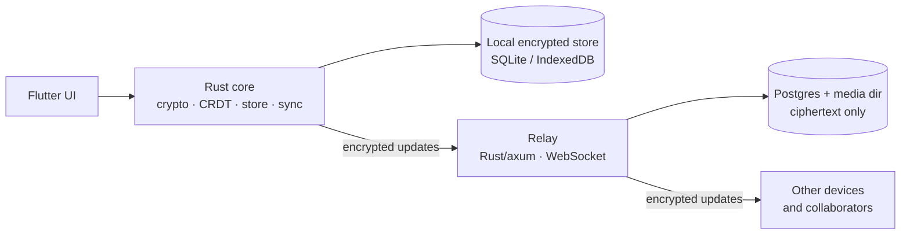

# EasyNotes

**Keep, but nobody can read it.** EasyNotes is a Google Keep-style notes and
lists app for Android and the web. Every note is sealed on the device before it
syncs, so the relay that stores it holds ciphertext and nothing else. A shared
note gets its second person in with a link, not an email address.

[](https://github.com/daniel-daga/easynotes/actions/workflows/ci.yml)
[](COPYING.md)

One Rust core handles crypto, CRDT merging, storage and sync. It drives a
Flutter UI on Android and the web — the two platforms exercised on hardware and
in browser tests — and builds for iOS, Linux and Windows without claiming them
for this launch. It talks to a relay that stores and forwards ciphertext and
nothing else.

---

> **Status: not production-ready.** Slices 1 and 2 are complete, and
> attachments work on native and on the web. Android has been built and
> exercised on a Pixel 10 Pro, where the signed `v0.1.5` draft installs, updates
> and restores from the recovery phrase; none of the drafts up to `v0.1.6` has
> been published, and the two-phone sharing journey is open. A Pixel 10 Pro +
> iPad run passed share, join, shared colour, attachments and revoke, but live
> collaboration needs polish, offline edits are unrun, and account deletion
> leaves a stale guest ([record](docs/two-phone-run-2026-10-26.md)). iOS builds
> upload to TestFlight; the iPad run is a partial device data point, not the iOS
> hardware walkthrough. See the
> [production readiness report](docs/production-readiness-2026-09-30.md),
> [`docs/slice-02-results.md`](docs/slice-02-results.md) and
> [`docs/plan-slice-03.md`](docs/plan-slice-03.md).

> **Not audited.** There has been one internal review of the cryptography, and no
> external audit. Do not rely on EasyNotes for anything where a flaw would put
> someone at risk. See [`SECURITY.md`](SECURITY.md).

## How it compares

Three apps people actually consider, and the gap that matters.

| App | What it gets right | Where it leaves a gap |
| --- | --- | --- |
| **Google Keep** | Free, instant, live shared lists, on Android and the web. | Google can read every note, and a Google account is required. |
| **Apple Notes** | Fast, free, live shared notes. | End-to-end encryption needs Advanced Data Protection turned on; Apple devices only. |
| **CryptPad** | Encrypted, live collaboration, self-hostable, and usable without an account. | A document suite, not a Keep-style list; no native mobile app. |

EasyNotes is the one that keeps Keep's shape, encrypts by default, and gets the
second person in with a link.

## Features

- **Text notes and checklists**, offline-first: every action works without a
  network and syncs later. Edits are batched (one envelope per pause, not per
  keystroke — [ADR 0016](docs/adr/0016-batching-edits.md)) and ride a single
  socket per device ([ADR 0017](docs/adr/0017-one-socket-per-device.md)).
- **End-to-end encryption** on every update: XChaCha20-Poly1305, signed with
  each author's Ed25519 device key, verified before decryption.
- **Live collaboration** through single-use, self-expiring invite links that
  carry no note key ([ADR 0015](docs/adr/0015-invites.md),
  [ADR 0025](docs/adr/0025-links-that-let-people-in.md)).
- **Sharing with people, not phones** — a collaborator is an account, so one
  person's several devices are one entry, and revocation rotates the note key
  ([ADR 0023](docs/adr/0023-access-packages.md)). A rename reaches every note
  the person is on, in either direction, because each member signs their own
  name into the note ([ADR 0032](docs/adr/0032-a-name-that-follows-the-person.md)).
- **Personal placement**: labels, pins, archive and trash are private to each
  device's account document; a colour is shared with everyone on the note, since
  two people looking at one list should see it the same shade (see the 2026-10-24
  amendment to [ADR 0008](docs/adr/0008-account-document.md)).
- **Labels** that are things, not words — renamable, mergeable, and able to
  outlive the notes that carry them.
- **Local full-text search** over a sealed index, which also draws the note
  grid ([ADR 0009](docs/adr/0009-search-index.md)).
- **Attachments** — photos and audio files encrypted in chunks under their own
  key, transferred over HTTP ([ADR 0027](docs/adr/0027-attachments.md)).
- **Reminders** as synced account state, scheduled locally
  ([ADR 0019](docs/adr/0019-reminders.md)).
- **Two devices from twelve words** — a BIP-39 recovery phrase that derives the
  account document ([ADR 0013](docs/adr/0013-recovery-phrase.md)).
- **Sync is one decision** — a sync server and the account that belongs to it
  are set up together; a local profile has neither. Without sync, notes stay on
  the device and are not backed up ([ADR 0032](docs/adr/0031-sync-is-a-server-and-an-account.md)).
- **Permanent deletion** of notes from the log, snapshot, index and key
  ([ADR 0010](docs/adr/0010-forgetting-a-note.md)).
- **Self-hostable relay** with storage quotas, per-address rate limits,
  Prometheus metrics, graceful shutdown and an optional access-key gate.

## Architecture

The app is local-first: each device holds its full data and merges changes with
a CRDT; the relay stores and forwards encrypted updates.



Each note is its own CRDT document. An edit becomes a CRDT update, is encrypted
under that note's key, and is sent to the relay under an opaque note ID. The
relay appends it to the note's log and forwards it to connected subscribers;
offline devices fetch what they missed on reconnect. Clients periodically
upload encrypted snapshots so the log can be compacted.

**What is backed up.** Sync is a server and the account that belongs to it,
made together. The relay keeps one encrypted replica; the twelve words are what
make it readable on another device. The relay cannot read it, and neither can
its operator. Without sync, a profile stays on this device and is not backed
up. An operator's database dump is disaster recovery for the relay, not a user
backup — without the account phrase it is ciphertext nobody can open. See
[ADR 0032](docs/adr/0031-sync-is-a-server-and-an-account.md) and
[ADR 0013](docs/adr/0013-recovery-phrase.md).

### Repository layout

```
core/    Rust: crypto, CRDT, local store, sync client. No Flutter, no platform policy.
relay/   Rust (axum): WebSocket relay over Postgres. Ciphertext only.
app/     Flutter app, plus the thin bridge crate in app/rust.
compat/  What each release wrote, read back by every later build's tests (ADR 0029).
docs/    Design, plans, and the decision records.
tools/   Measurement helpers and build checks that are not part of the product.
```

`core` stays callable from a plain `cargo test` with no Flutter in the loop.
That is what keeps the security-critical code auditable, and it is not
negotiable.

## Security

Every note has its own key, wrapped by a master key held in the OS keychain (or
the browser's nearest equivalent). The recovery phrase derives the account
root, but **not** the note keys — those stay random and ride inside the account
document's ciphertext, so they can be rotated and shared keys have somewhere to
live. Every update is encrypted with XChaCha20-Poly1305 and signed with the
author's Ed25519 device key; receivers verify the signature before they
decrypt, and the AAD binds the note, the author and a counter so an envelope
cannot be moved between notes or re-attributed.

The relay holds no keys and never sees plaintext. It may check a token, a size,
and that an envelope's note ID matches the note it was sent for — nothing else.
`the_relay_never_sees_plaintext` enforces that against the actual bytes on the
wire, and the same check runs against the local database and its write-ahead
log. What the relay does learn is documented in
[ADR 0014](docs/adr/0014-what-the-relay-learns.md).

For scope, reporting, and the known limitations, see
[`SECURITY.md`](SECURITY.md). The design schedules an external audit before 1.0
and nothing here should be relied on until then.

## Prerequisites

- A stable Rust toolchain
- [Flutter](https://flutter.dev)
- [`just`](https://github.com/casey/just)

The web build additionally needs a nightly toolchain and `wasm-pack`;
`just setup-web` installs them plus `wasm-bindgen-cli`.

## Development

```sh
just test-core        # the core and everything under it, no Flutter needed
just test-all         # core, relay and app
just run-relay        # a relay on 127.0.0.1:8080, storing in memory
just run-linux        # the app on Linux desktop, over the real core
just --list           # everything else
```

Set `DATABASE_URL` to run the relay on Postgres and include its tests; without
it they skip, and a green run without it is a run that skipped the tests that
matter there.

**Two-device demo:** run `just run-relay` in one terminal and `just run-linux`
in another — twice for two devices. In each app, open the drawer's
**Sync & devices → Switch server → Connect another server** and enter
`http://127.0.0.1:8080`.

On a new install, notes start **On this device** until a relay is selected. An
account and its recovery phrase let a second device find and unlock the same
notes on the same relay. To share a list, open it and send the link the share
button makes — the link carries no key: the first person to open it joins, and
nobody after them can.

### Web build

```sh
just setup-web        # nightly toolchain, wasm-pack, wasm-bindgen-cli
just build-web        # threaded-WASM web app
```

The web build needs `Cross-Origin-Opener-Policy: same-origin` and
`Cross-Origin-Embedder-Policy: require-corp` when served, because the
WebAssembly is threaded and will not start without cross-origin isolation.

Four browser recipes exercise the result headlessly (each needs `just build-web`
first): `just web-smoke`, `just web-sync-smoke`, `just web-converge` and
`just web-storage-failure`. `just web-shared-text` verifies the incoming share
route. `just bench-web` measures opening a device in a browser.

## Running a relay

The relay is a single binary, `easynotes-relay`. It stores in memory unless
`DATABASE_URL` names a Postgres database. Configuration is by environment
variable:

| Variable | Default | Purpose |
| --- | --- | --- |
| `DATABASE_URL` | unset (in-memory) | Postgres connection string |
| `RELAY_ADDR` | `127.0.0.1:8080` | Listen address (the Docker image sets `0.0.0.0:8080`) |
| `RELAY_ALLOWED_ORIGINS` | any | Browser origins allowed to handshake (comma-separated) |
| `RELAY_TOKEN_SIGNING_KEY` | temporary process key | Base64url 32-byte Ed25519 seed for device tokens; keep stable across restarts and instances |
| `RELAY_ACCESS_KEYS` | `open` | Who may write: base64url keys (comma-separated), or `open` for anyone ([ADR 0028](docs/adr/0028-who-may-write-to-a-relay.md)) |
| `RELAY_WRITE_BURST` | 200 MiB | Bytes one client address may write at once |
| `RELAY_WRITE_PER_HOUR` | 200 MiB/hr | Sustained write budget per address (`off` for none) |
| `RELAY_STORAGE_CEILING` | 16 GiB | Total live-log bytes before the relay refuses new notes (`off` for none) |
| `RELAY_MEDIA_DIR` | unset | Where attachment bytes live; back up with the database |
| `RELAY_MEDIA_PER_NOTE` | 1 GiB | Attachment bytes one note may hold |
| `RELAY_MEDIA_CEILING` | 64 GiB | Attachment bytes all notes may hold together (`off` for none) |
| `RELAY_TRUSTED_PROXIES` | unset | Addresses/CIDRs to trust `X-Forwarded-For` from, so clients behind a proxy aren't one rate-limit bucket |
| `RELAY_RATE_LIMIT` | on | `off` answers as fast as asked (development only) |
| `RELAY_DRAIN_SECONDS` | 8 | Graceful-shutdown drain before exiting on `SIGTERM` |
| `RELAY_METRICS_ADDR` | unset | Serves Prometheus `/metrics` on a separate listener (e.g. `0.0.0.0:9090`) |

Generate keys with `easynotes-relay access-key` for access keys, and
`openssl rand -base64 32 | tr '+/' '-_' | tr -d '=\n'` for the token signing
key.

The relay answers `/v1/health` (process up), `/v1/ready` (process up and
database answering), and `/metrics`. `easynotes-relay check` asks `/v1/ready`
and exits 0 or 1 — the container health check.

## Deployment

For a small private deployment on a Synology NAS — building the relay container,
running Postgres with persistent storage, DSM's reverse proxy for HTTPS and
WebSockets, backups, monitoring and key rotation — see
[`deploy/synology/README.md`](deploy/synology/README.md).

The container image is built from the root `Dockerfile` and runs the relay as a
non-root user. Prometheus alert rules (at 80% of each ceiling, among others)
are in [`deploy/prometheus/alerts.yml`](deploy/prometheus/alerts.yml).

Production relays should set `RELAY_TOKEN_SIGNING_KEY` to a stable key shared by
every instance, and `RELAY_ACCESS_KEYS` to restrict writes. The Synology Compose
file refuses to start without both.

## Documentation

- [Design document](docs/design.md) — product and architecture
- [Market position](docs/market-report.md) — competitors, and where EasyNotes fits
- [Production readiness report](docs/production-readiness-2026-09-30.md)
- [Security policy](SECURITY.md) and [crypto review](docs/crypto-review.md)
- [Synology deployment](deploy/synology/README.md)
- [Windows desktop](docs/windows-desktop.md), [Android release](docs/android-release.md), [iOS release](docs/ios-release.md)
- [Decision records](docs/adr/) — see the table below

### Decision records

| | |
| --- | --- |
| [ADR 0001](docs/adr/0001-crdt.md) | CRDT: Yrs, with items in a map and fractional order keys |
| [ADR 0002](docs/adr/0002-web-core.md) | One Rust core everywhere, including the web |
| [ADR 0003](docs/adr/0003-relay.md) | Relay: Rust and axum, Postgres for the log |
| [ADR 0004](docs/adr/0004-sync-engine.md) | Sync: an outbox derived from the log, acknowledged by echo |
| [ADR 0005](docs/adr/0005-local-store.md) | Local store: SQLite with sealed values, not SQLCipher |
| [ADR 0006](docs/adr/0006-compaction.md) | Compaction: the log keeps what the relay has not acknowledged |
| [ADR 0007](docs/adr/0007-note-list.md) | The note list: listing notes means opening them |
| [ADR 0008](docs/adr/0008-account-document.md) | The account document: a document like any other, made of registers |
| [ADR 0009](docs/adr/0009-search-index.md) | Local search, over a sealed index that the note list reads too |
| [ADR 0010](docs/adr/0010-forgetting-a-note.md) | Forgetting a note: what a delete removes, and what it cannot |
| [ADR 0011](docs/adr/0011-the-web-store.md) | The store a browser gets: reads from memory, writes through Dart |
| [ADR 0012](docs/adr/0012-compacting-the-account-document.md) | Compacting the account document: the snapshot goes in the log |
| [ADR 0013](docs/adr/0013-recovery-phrase.md) | The recovery phrase: twelve words deriving one document, and not the note keys |
| [ADR 0014](docs/adr/0014-what-the-relay-learns.md) | What the relay learns about a person: nothing new |
| [ADR 0015](docs/adr/0015-invites.md) | Invite links: a secret that asks, and an owner who answers (*amended by 0025:* nobody approves) |
| [ADR 0016](docs/adr/0016-batching-edits.md) | Batching edits: typing waits for a pause, and goes as one envelope |
| [ADR 0017](docs/adr/0017-one-socket-per-device.md) | One socket per device: every note on it, and reading never waits for writing |
| [ADR 0018](docs/adr/0018-revocation.md) | Revocation is a creator-signed key generation |
| [ADR 0019](docs/adr/0019-reminders.md) | Reminders are account state mirrored to local schedulers |
| [ADR 0020](docs/adr/0020-collaborator-directory.md) | *Superseded by 0023:* an encrypted collaborator directory |
| [ADR 0021](docs/adr/0021-stateless-relay-tokens.md) | Stateless relay tokens: signed expiry and shared one-use challenges |
| [ADR 0022](docs/adr/0022-account-wide-deletion.md) | Permanent deletion across one person's devices |
| [ADR 0023](docs/adr/0023-access-packages.md) | Share with people: account member keys and access packages |
| [ADR 0024](docs/adr/0024-relay-storage-quota.md) | A storage quota for an anonymous relay: members compact a note's log to a base |
| [ADR 0025](docs/adr/0025-links-that-let-people-in.md) | A link lets its first person in, once: no approval, no safety code |
| [ADR 0026](docs/adr/0026-deleting-an-account.md) | Deleting an account: the relay purges what the person owns and keeps a tombstone |
| [ADR 0027](docs/adr/0027-attachments.md) | Attachments: descriptors in the note, media in sealed chunks beside it (§1–§4 accepted and built, with the first UI; §5, relay clean-up, proposed) |
| [ADR 0028](docs/adr/0028-who-may-write-to-a-relay.md) | Who may write to a relay: a shared access key proven at the handshake, a per-address write budget, no relay for strangers yet |
| [ADR 0029](docs/adr/0029-compatibility-across-releases.md) | Compatibility across releases: what stays readable, a refusable protocol version, migrations tested from every release's fixtures (accepted and built; the old-relay-against-new-client job follows the first tag) |
| [ADR 0030](docs/adr/0030-a-link-lets-its-first-person-in.md) | A link lets its first person in, without the owner's phone: the invite carries a pre-sealed grant |
| [ADR 0032](docs/adr/0031-sync-is-a-server-and-an-account.md) | Sync is a server and the account that belongs to it: one setup, no upload before the account, and what "backup" means |
| [ADR 0032](docs/adr/0032-a-name-that-follows-the-person.md) | A name that follows the person: each member signs their own name into the note, so a rename reaches collaborators both ways |
| [ADR 0034](docs/adr/0034-leaving-on-account-deletion.md) | A guest leaves when their account is deleted: a signed record in each joined note, a removal and a key rotation on the owner's next sync |

## Reporting a vulnerability

Please report privately through GitHub's **Security → Report a vulnerability**,
not a public issue. See [`SECURITY.md`](SECURITY.md) for scope, expectations and
safe harbour.

## Licence

EasyNotes is free software under the GNU Affero General Public License,
version 3 or later ([`LICENSE`](LICENSE)). Bundled third-party components keep
their own compatible licences; see [`COPYING.md`](COPYING.md).
