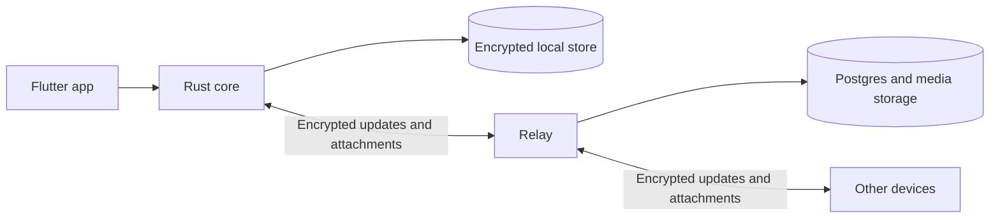

# EasyNotes

**Local-first, end-to-end encrypted notes and checklists.**

[](https://github.com/daniel-daga/easynotes/actions/workflows/ci.yml)
[](LICENSE)

EasyNotes lets you write notes offline, sync them across devices, and share
them through invite links without an email account. Note content is encrypted
on your device before it reaches the sync server (the relay). You can also use
the app locally without a relay, or host your own relay.

The app uses a Flutter interface and a shared Rust core for encryption,
storage, conflict resolution and sync.

## Project status

**EasyNotes is under active development and is not production-ready.** No app
store release has been published. Build from source to try it, and use test
data rather than important notes.

- **Android and web** are the primary development targets, with device and
  browser testing.
- **iOS, Linux and Windows** have build support, but runtime validation is
  incomplete. Build support is not a guarantee of feature parity.
- Sharing and live collaboration are implemented, but still need usability
  improvements and further multi-device testing.

**The project has not been externally security-audited.** Do not use it for
information whose disclosure or loss could put someone at risk. See the
[security policy and known limitations](SECURITY.md).

## Features

- **Offline notes and checklists** with automatic merging of concurrent edits.
- **End-to-end encrypted sync**, using XChaCha20-Poly1305 encryption and
  Ed25519 device signatures.
- **Shared notes** through single-use invite links. Removing a collaborator
  rotates the note key for future updates.
- **Organisation** with labels, pins, colours, archive and trash. Labels and
  placement are personal; a note's colour is shared with its collaborators.
- **Local full-text search** backed by an encrypted index.
- **Encrypted photo and audio attachments.**
- **Reminders** stored as encrypted account state and scheduled locally.
- **Multi-device recovery** with a twelve-word recovery phrase on the same
  relay.
- **Self-hosting** with a Rust relay, Postgres storage, access controls,
  storage quotas and Prometheus metrics.

Local-only notes are not backed up by a relay. For synced accounts, keep the
recovery phrase safe: the relay operator cannot recover your encryption keys.
Sync is not a substitute for an independent backup.

## Getting started

### Prerequisites

- A stable [Rust toolchain](https://rustup.rs/).
- [`just`](https://github.com/casey/just), the project's command runner.
- For the app: [Flutter](https://docs.flutter.dev/get-started/install) and the
  platform-specific build tools. CI currently uses Flutter **3.47.5**; see
  [the CI configuration](.github/workflows/ci.yml) for the tested version.
- For persistent relay storage and database tests: **Postgres 16**.

The `just` recipes use a Unix-style shell; on Windows, use Git Bash for these
commands. Native Windows build instructions are in
[Windows desktop](docs/windows-desktop.md).

```sh
git clone https://github.com/daniel-daga/easynotes.git
cd easynotes
just test-core
```

The Rust core can be built and tested without Flutter or a running relay.

### Run the app

Install the bridge generator for app recipes that regenerate the bindings,
then fetch the Flutter dependencies:

```sh
cargo install flutter_rust_bridge_codegen --version 2.13.0 --locked
cd app
flutter pub get
cd ..
```

Keep the generator version aligned with `flutter_rust_bridge` in
[`app/pubspec.yaml`](app/pubspec.yaml). See
[`third_party/README.md`](third_party/README.md) before upgrading the bridge.

For a Linux desktop development build, install Flutter's Linux prerequisites
and the `libsecret` development package, then run:

```sh
just run-linux
```

For Android, connect a device or start an emulator, then run `flutter run`
from `app/`. Platform build guides are linked under [Documentation](#documentation).

To try sync, start a development relay in a separate terminal:

```sh
just run-relay
```

Select the relay in the app's **Relay settings**. The default address is
`http://127.0.0.1:8080`; a physical device needs an address it can reach on
your development machine instead of its own loopback address.

**The default development relay stores data in memory and loses it on exit.**
Set `DATABASE_URL` for Postgres persistence. Do not expose the development
configuration to the internet; see [Self-hosting](#self-hosting).

### Web build

After the app setup above:

```sh
just setup-web
just build-web
python3 tools/web-smoke/serve.py app/build/web 8099
```

Open <http://127.0.0.1:8099>. `just setup-web` installs the additional Rust/WASM
tooling. The included development server sets the cross-origin isolation
headers required by threaded WebAssembly; a plain static server without those
headers will not work.

## Development and tests

Run commands from the repository root:

```sh
just test-core        # Rust core; no Flutter required
just test-app         # Builds the native bridge and relay, then tests the app
just lint             # Rust formatting, host/WASM Clippy and Flutter analysis
just --list           # All available recipes
```

For relay tests, set `DATABASE_URL` to a dedicated Postgres 16 test database
and run them serially, as CI does:

```sh
cargo test -p easynotes-relay -- --test-threads=1
```

Without `DATABASE_URL`, database-dependent tests skip. Use `just test-app`
rather than plain `flutter test` so real-core and sync tests have the binaries
they need. Browser checks such as `just web-smoke` and `just web-converge`
require a prior `just build-web`, Node.js, Python and Chromium. See
[CONTRIBUTING.md](CONTRIBUTING.md) for the contribution workflow.

## Architecture



Each note is a CRDT document. Devices merge edits locally, and the relay
stores and forwards encrypted updates. The relay cannot read note content,
but it sees metadata such as opaque note IDs, device public keys, message
sizes, timing and connection addresses. Revoking access cannot erase copies
a collaborator has already received.

| Directory | Purpose |
| --- | --- |
| [`core/`](core/) | Rust encryption, CRDTs, local storage and sync client |
| [`relay/`](relay/) | Rust/axum sync server and Postgres storage |
| [`app/`](app/) | Flutter UI and Rust bridge in `app/rust/` |
| [`compat/`](compat/) | Stored-format compatibility fixtures |
| [`docs/`](docs/) | Architecture, decisions and platform guides |
| [`deploy/`](deploy/) | Deployment instructions and monitoring configuration |
| [`tools/`](tools/) | Build checks, browser tests and measurement tools |

Read [How EasyNotes works](docs/architecture.md) for the data model, sharing
and recovery flow, and [Architecture decisions](docs/decisions.md) for the
design choices.

## Self-hosting

The relay can run as a Rust binary or a container built from the root
[`Dockerfile`](Dockerfile). Persistent deployments use Postgres and a media
directory for encrypted attachments; back up both.

The [relay guide](docs/relay.md) covers standalone setup, configuration and
device-token management. The [Synology guide](deploy/synology/README.md) provides a reference
deployment using Synology Container Manager, including configuration, HTTPS,
WebSocket proxying, access keys, backups, updates and monitoring. The example
settings are in [`.env.example`](.env.example). Use persistent storage, a stable
token-signing key and restricted access before making a relay reachable over
the network. Never expose the relay's admin listener publicly.

Account transfers currently require a single relay process: pending pairings
are held in memory and do not survive a restart or work across instances.

## Documentation

- [Architecture](docs/architecture.md)
- [Architecture decisions](docs/decisions.md)
- [Security policy](SECURITY.md)
- [Relay configuration](docs/relay.md)
- [Self-hosting guide](deploy/synology/README.md)
- [Windows desktop](docs/windows-desktop.md)
- [Android release builds](docs/android-release.md)
- [iOS release builds](docs/ios-release.md)

## Contributing and reporting issues

Bug reports, documentation improvements, tests and code contributions are
welcome. Read [CONTRIBUTING.md](CONTRIBUTING.md) before opening a pull request
and follow the [Code of Conduct](CODE_OF_CONDUCT.md).

For non-security bugs and feature requests, use
[GitHub Issues](https://github.com/daniel-daga/easynotes/issues). Include steps
to reproduce, the platform and the version or commit you tested. Do not
include private notes, recovery phrases, keys or other sensitive data.

**Report vulnerabilities privately**, not through public issues or pull
requests. Follow the reporting instructions in [SECURITY.md](SECURITY.md).

## License

EasyNotes is free software licensed under the
[GNU Affero General Public License, version 3 or later](LICENSE)
(`AGPL-3.0-or-later`). Bundled third-party components retain their own
licenses; see [COPYING.md](COPYING.md).
