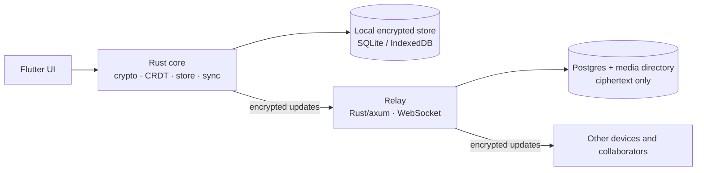

# How EasyNotes works

EasyNotes is a local-first notes and lists app for Android and the web. Every
note is sealed on the device before it syncs, so the relay that stores it holds
ciphertext and nothing else. Sharing a note sends a link, not an email
invitation.

This page is the public overview. The decisions behind the details are indexed
in [`decisions.md`](decisions.md); the security model and its limits are in
[`../SECURITY.md`](../SECURITY.md).

## Pieces



- **`core/`** is the Rust core: cryptography, CRDT merging, the local store,
  attachments and the sync client. It has no Flutter dependency and is callable
  from a plain `cargo test`.
- **`relay/`** is the sync server: a Rust/axum binary over Postgres. It stores
  and forwards opaque envelopes, enforces quotas and rate limits, and serves
  attachment chunks.
- **`app/`** is the Flutter UI and the thin Rust bridge. Android and the web are
  the platforms exercised today; iOS, Linux and Windows builds exist but are not
  claimed as launch targets.

## A note

Each note is its own CRDT document under a random note ID. A note has a title,
items, a kind (text or checklist) and, when shared, a member list and a colour.
Items are kept in a map and ordered by fractional order keys, so two people
editing the same list converge without a central sequence
([ADR 0001](decisions.md#adr-0001), [ADR 0007](decisions.md#adr-0007)).

Personal state is not in the note. Placement, pinning, labels, the archive and
trash live in a private account document, one per person, under a reserved ID.
It is a CRDT like any note and syncs the same way
([ADR 0008](decisions.md#adr-0008)). A label's name and colour live in the
account document too; a note carries the label IDs.

Attachments are descriptors on the note. The bytes are sealed in chunks under a
key derived for that attachment and transferred over HTTP, so the relay stores
opaque chunks beside the note's log ([ADR 0027](decisions.md#adr-0027)).

## Sync

An edit becomes a CRDT update, is encrypted under the note's key, signed by the
author's device key and appended to the local log. The sync engine derives an
outbox from the log, sends it over one authenticated WebSocket per device, and
treats the relay's echo as the acknowledgement. Settlement trims the outbox
([ADR 0004](decisions.md#adr-0004), [ADR 0017](decisions.md#adr-0017)).

Typing is held until a short pause and sent as one envelope; a single gesture
goes at once ([ADR 0016](decisions.md#adr-0016)). A device periodically uploads
an encrypted snapshot so the relay can compact the log to a base and keep the
replay cost bounded ([ADR 0006](decisions.md#adr-0006),
[ADR 0024](decisions.md#adr-0024)). The local store is SQLite on native and
IndexedDB-backed memory on the web, with every value sealed
([ADR 0005](decisions.md#adr-0005), [ADR 0011](decisions.md#adr-0011)).

## Sharing

A share link carries a random secret in its URL fragment. The owner's device
pre-seals a grant for that secret, so the first person to open the link joins
without an email address, an invitation queue or the owner's phone being online
([ADR 0015](decisions.md#adr-0015), [ADR 0025](decisions.md#adr-0025),
[ADR 0030](decisions.md#adr-0030)).

A collaborator is an account, not a device: one person's several devices are one
entry. Access packages carry the note key wrapped for each member's devices, and
removing someone rotates the key so later updates are not readable by them
([ADR 0023](decisions.md#adr-0023), [ADR 0018](decisions.md#adr-0018)). Each
member signs their own display name into the note, so a rename follows the
person ([ADR 0032](decisions.md#adr-0032)).

## Accounts and recovery

An account is twelve words, generated once and shown once. The BIP-39 phrase
derives the account root and the account keys, but not the note keys; those stay
random and travel inside the encrypted account document
([ADR 0013](decisions.md#adr-0013)). A second device enters the phrase and
finds the same encrypted account on the same relay.

A profile has a sync server if and only if it has an account. A local-only
profile has neither, keeps its notes on the device and is not backed up
([ADR 0031](decisions.md#adr-0031)). On a relay, "backup" means the encrypted
replica plus the phrase that makes it readable; the operator cannot restore it.

## Deletion

Deleting a note removes its log, snapshot, index entry and key from the device
([ADR 0010](decisions.md#adr-0010)). Permanent deletion across one person's
devices writes a monotonic marker into their account document
([ADR 0022](decisions.md#adr-0022)). Deleting an account sends a signed purge
for what it owns; the relay deletes the data and keeps a tombstone, and a guest
signs a "left" record into notes they joined
([ADR 0026](decisions.md#adr-0026), [ADR 0034](decisions.md#adr-0034)).

What deletion cannot do is recall copies that other people already have. A
person who has read a shared note keeps what they read, and a backup taken
before a deletion still contains the ciphertext it contained.

## Security

Every note has its own key, wrapped by a master key held in the OS keychain (or
the browser's nearest equivalent). Every update is encrypted with
XChaCha20-Poly1305 and signed with the author's Ed25519 device key. Receivers
verify the signature before decrypting, and the associated data binds the note,
the author and a counter, so an envelope cannot be moved between notes or
re-attributed ([ADR 0014](decisions.md#adr-0014),
[ADR 0021](decisions.md#adr-0021)).

The relay holds no keys and never sees plaintext. It can check a token, a size,
and that an envelope's note ID matches the note it was sent for. It still sees
metadata: opaque note IDs, device public keys, sizes, timing and the addresses
devices connect from. The full threat model and the known limitations are in
[`../SECURITY.md`](../SECURITY.md).

## Repository layout

```
core/    Rust: crypto, CRDT, local store, sync client. No Flutter, no platform policy.
relay/   Rust (axum): WebSocket relay over Postgres. Ciphertext only.
app/     Flutter app, plus the thin bridge crate in app/rust.
compat/  What each release wrote, read back by every later build's tests.
docs/    Public architecture, decision summaries, build and deployment guides.
tools/   Measurement helpers and build checks that are not part of the product.
```

`core` stays callable from a plain `cargo test` with no Flutter in the loop.
That is what keeps the security-critical code auditable.
